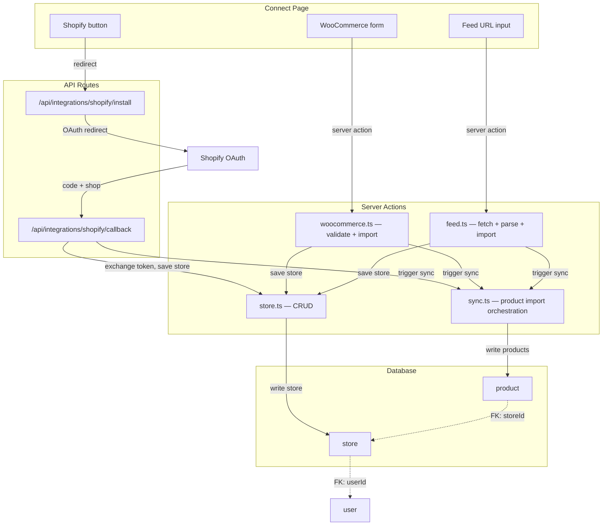

# Real E-Commerce Platform Integrations

## What you need before writing code

### External accounts / credentials


| Platform        | What you need                                                                                    | Where to get it                                                                                                                                   |
| --------------- | ------------------------------------------------------------------------------------------------ | ------------------------------------------------------------------------------------------------------------------------------------------------- |
| **Shopify**     | A **Shopify Partner** account + a custom app with `read_products` scope                          | [partners.shopify.com](https://partners.shopify.com) — create app, set redirect URI to `{BETTER_AUTH_BASE_URL}/api/integrations/shopify/callback` |
| **WooCommerce** | Nothing on your side — the *merchant* generates a consumer key/secret in their WooCommerce admin | WooCommerce > Settings > REST API > Add Key                                                                                                       |
| **Custom Feed** | Nothing — user pastes a URL                                                                      | N/A                                                                                                                                               |


### New environment variables

```
SHOPIFY_API_KEY=         # from Shopify Partner dashboard
SHOPIFY_API_SECRET=      # from Shopify Partner dashboard
```

WooCommerce and Custom Feed need no server-side env vars (credentials are per-store, stored in the DB).

---

## Architecture




---

## 1. Database schema — new tables

Add to [apps/web/src/server/database/schema.ts](apps/web/src/server/database/schema.ts):

`**store**` — one row per connected store

```typescript
export const store = pgTable("store", {
  id: text("id").primaryKey().default(sql`gen_random_uuid()::text`),
  userId: text("userId").notNull().references(() => user.id, { onDelete: "cascade" }),
  platform: text("platform").notNull(),       // "shopify" | "woocommerce" | "feed"
  name: text("name").notNull(),               // display name / shop name
  domain: text("domain").notNull(),           // store URL or feed URL
  accessToken: text("accessToken"),           // Shopify OAuth token (encrypted at rest by PG or app-level)
  consumerKey: text("consumerKey"),           // WooCommerce
  consumerSecret: text("consumerSecret"),     // WooCommerce
  feedUrl: text("feedUrl"),                   // Custom feed URL
  status: text("status").notNull().default("connected"), // connected | syncing | error | disconnected
  lastSyncedAt: timestamp("lastSyncedAt", { mode: "date" }),
  createdAt: timestamp("createdAt", { mode: "date" }).notNull().defaultNow(),
  updatedAt: timestamp("updatedAt", { mode: "date" }).notNull().defaultNow(),
});
```

`**product**` — imported products across all stores

```typescript
export const product = pgTable("product", {
  id: text("id").primaryKey().default(sql`gen_random_uuid()::text`),
  storeId: text("storeId").notNull().references(() => store.id, { onDelete: "cascade" }),
  userId: text("userId").notNull().references(() => user.id, { onDelete: "cascade" }),
  externalId: text("externalId"),             // platform-side product ID
  title: text("title").notNull(),
  description: text("description"),
  price: text("price"),                       // stored as string to avoid float issues
  compareAtPrice: text("compareAtPrice"),
  currency: text("currency").default("USD"),
  images: text("images").default("[]"),       // JSON array of image URLs
  url: text("url"),                           // product page link
  sku: text("sku"),
  status: text("status").default("active"),   // active | draft | archived
  rawData: text("rawData"),                   // full API response (JSON stringified)
  syncedAt: timestamp("syncedAt", { mode: "date" }),
  createdAt: timestamp("createdAt", { mode: "date" }).notNull().defaultNow(),
  updatedAt: timestamp("updatedAt", { mode: "date" }).notNull().defaultNow(),
});
```

Add relations for both, then run `drizzle-kit generate` + `drizzle-kit migrate`.

---

## 2. Shopify integration (OAuth)

### Flow

1. User clicks "Connect Shopify" -> prompted for their `myshopify.com` domain
2. Redirect to `**/api/integrations/shopify/install?shop={domain}**`
3. That route builds the Shopify OAuth URL and redirects the user to Shopify
4. Merchant authorizes -> Shopify redirects to `**/api/integrations/shopify/callback?code=X&shop=Y**`
5. Callback route exchanges the code for an access token, creates a `store` row, triggers product sync, redirects to `/onboarding/select-products`

### Files to create

- `**apps/web/src/app/api/integrations/shopify/install/route.ts**` — GET handler, builds OAuth URL, redirects
- `**apps/web/src/app/api/integrations/shopify/callback/route.ts**` — GET handler, exchanges code, saves store + token
- `**apps/web/src/server/app/integration/shopify.ts**` — `syncProducts(storeId)` server action that calls Shopify Admin API `GET /admin/api/2024-10/products.json` with the stored access token, maps response to `product` rows

### Shopify API details

- **Scopes needed**: `read_products` (minimum), optionally `read_product_listings`
- **Token exchange**: POST `https://{shop}/admin/oauth/access_token` with `{ client_id, client_secret, code }`
- **Product fetch**: GET `https://{shop}/admin/api/2024-10/products.json?limit=250` (paginated via `Link` header)

---

## 3. WooCommerce integration (API key)

### Flow

1. User clicks "Connect WooCommerce" -> a dialog opens with three fields: **Store URL**, **Consumer Key**, **Consumer Secret**
2. Server action validates the credentials by calling `GET {storeUrl}/wp-json/wc/v3/products?per_page=1` with basic auth
3. If valid, create a `store` row, trigger product sync
4. Redirect to `/onboarding/select-products`

### Files to create

- `**apps/web/src/server/app/integration/woocommerce.ts`** — `connect(url, key, secret)` validates + creates store, `syncProducts(storeId)` fetches products via REST API

### WooCommerce API details

- **Auth**: Basic auth header — `Authorization: Basic base64(consumer_key:consumer_secret)`
- **Product fetch**: GET `{storeUrl}/wp-json/wc/v3/products?per_page=100&page=N`
- **Pagination**: response headers `X-WP-Total`, `X-WP-TotalPages`

---

## 4. Custom Feed integration (URL)

### Flow

1. User clicks "Custom Feed" -> input field for feed URL
2. Server action fetches the URL, detects format (XML or JSON), parses products
3. Creates `store` row + `product` rows
4. Redirect to `/onboarding/select-products`

### Files to create

- `**apps/web/src/server/app/integration/feed.ts`** — `connect(feedUrl)` fetches + parses, `syncProducts(storeId)` re-fetches

### Supported formats

- **Google Shopping XML** (most common) — parse `<item>` elements for `<g:title>`, `<g:price>`, `<g:image_link>`, `<g:link>`, etc.
- **JSON** — expect an array of objects with `title`, `price`, `image`, `url` fields

Use a lightweight XML parser like `fast-xml-parser` (add to dependencies).

---

## 5. Shared sync orchestration

`**apps/web/src/server/app/sync.ts`** — dispatches to the right platform-specific sync function based on `store.platform`. Updates `store.status` to `"syncing"` at start, `"connected"` on success, `"error"` on failure. Sets `store.lastSyncedAt`.

---

## 6. Connect page UI changes

Update [apps/web/src/app/(auth)/onboarding/connect/page.tsx](apps/web/src/app/(auth)/onboarding/connect/page.tsx):

- **Shopify card**: Opens a small dialog asking for `myshopify.com` domain, then redirects to `/api/integrations/shopify/install?shop={domain}`
- **WooCommerce card**: Opens a dialog with `InferredForm` (store URL, consumer key, consumer secret), calls server action
- **Custom Feed card**: Opens a dialog with a single URL input, calls server action
- All cards show loading state during connection, then redirect on success
- The page becomes a `"use client"` component (already is) with `useState` for which dialog is open

---

## 7. Environment variable declarations

Update [apps/web/declarations/environment.d.ts](apps/web/declarations/environment.d.ts) to add `SHOPIFY_API_KEY` and `SHOPIFY_API_SECRET`.

---

## Implementation order

Start with **WooCommerce** (simplest — no OAuth, just a form + API call), then **Custom Feed** (also simple), then **Shopify** (requires OAuth routes + partner account setup). This way the DB schema and sync infrastructure are proven before tackling the most complex integration.