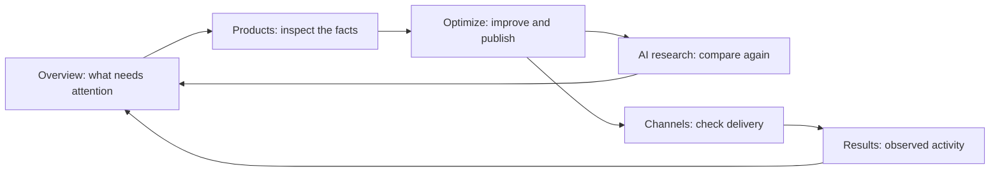

# Dashboard proposal: fewer destinations, a clearer improvement loop

Approved for implementation · 13 November 2026

**Recommendation: reduce the 15 store navigation destinations to six. Keep the capabilities, but group them around merchant tasks. Prioritize the connection between a finding, an approved change, and a measured follow-up before adding more scores or tools.** The user approved the navigation and page redesign. Existing route URLs remain valid; the shared navigation now groups them into these six destinations. Saved drafts, field-level approval, durable publishing receipts and change-linked follow-up measurements below remain subsequent product work, not capabilities promised by this visual consolidation.

## What the dashboard needs to answer

A merchant should be able to arrive, understand the next useful action, finish it, and see whether it helped:

1. Is my catalog connected and current?
2. What prevents my products from being understood, compared, or sold?
3. What should I change, and what evidence supports the change?
4. Where will the change be published, and what needs my approval?
5. What happened after it was published?

The current app contains much of the underlying functionality. The difficulty is finding the right surface and interpreting what each result means. A model comparison, a storefront check, a catalog rank, and a referral count are different kinds of evidence. They should remain distinguishable even when their screens are grouped.

## Approved navigation

| Main destination | What belongs there | Default view |
| --- | --- | --- |
| **Overview** | Current blockers, next actions, recent changes, a small measured summary | At most three prioritized next steps, with evidence and a direct action |
| **Products** | Catalog, product detail, deterministic data quality, source and sync information | Searchable catalog; Data quality is a subpage in the Products sidebar group |
| **Optimize** | Candidate improvements, review and publishing, dismissed items, published history | Work that can be acted on, with the product and proposed destination clear |
| **AI research** | Product simulations, saved answers/replays, brand analysis, shopper-query discovery, competitor setup | Most recent research run; explicit labels for simulated answers versus observed catalog results |
| **Channels** | Source connections, Google delivery, feeds, storefront access, checkout readiness | Relevant connections with their last check, status, and next step |
| **Results** | Observed AI referrals and requests, qualifying order attribution, downloadable reports | A stated time window and separate metrics for referrals, requests, and attributed orders when supported |

All stores stays in the store selector. Account, billing, notifications, preferences, and team settings stay in the account/settings area. Judy stays contextual; it does not become another navigation category.

### What happens to every current destination

Paths below are relative to `/dashboard/[store]`, unless stated otherwise.

| Current page | Proposed home | Decision |
| --- | --- | --- |
| Overview | Overview | Keep, shorten, make actions the lead |
| Products / product detail | Products | Keep; this is the product record and place to inspect one listing |
| Data Quality | Products → Data quality | Keep the detailed audit; surface actionable findings in Optimize without duplicating the editor |
| Optimize | Optimize | Keep as the work queue, review, publishing, and change history |
| Brand | AI research → Brand analysis | Keep; brand questions are different from head-to-head product tests |
| Competitors | AI research → Competitors | Keep as setup and comparative evidence, close to the runs that use it |
| Simulations | AI research → Product comparisons | Keep; show run scope, time, models, denominators, and saved evidence |
| Discovery | AI research → Shopper questions | Keep as exploratory research; current generated suggestions are not a live universal search rank |
| Visibility | Split between Channels → Storefront checks and AI research → Catalog rank | The current page combines readiness/feed setup and a Shopify Global Catalog query. Separate these jobs while preserving each result's provenance |
| Agentic Score | Channels → Storefront checks | Keep the existing check report and methodology; avoid presenting it as a second overall success KPI |
| WebMCP | Channels → Developer tools → Shopping tools | Keep source-audit evidence and its limitations; do not pretend it verifies live checkout execution |
| Google Shopping | Channels → Google | Keep configuration, consent, offer records, and processing issues together |
| UCP | Channels → Checkout | Keep supported setup and profile details; introduce the merchant task before the protocol name |
| UCP Playground | Channels → Developer tools → Test checkout | Keep advanced inspection available; a normal merchant should not need it to understand the product |
| UCP Comparison | Channels → Developer tools → Compare checkout profiles | Keep as an advanced tool, not a daily navigation destination |
| `/dashboard/reports` | Results → Reports | Keep export/report capability, with account/store scope stated |
| `/dashboard/settings` | Account → Settings | Keep; deep-link connection setup from Channels instead of duplicating forms |

This is a reduction in navigation, not a recommendation to throw away working features. Preserve existing deep links during a transition and add redirects only after the destination is agreed and tested.

## Overview: useful in one screen

The overview should lead with **what needs attention**, not a wall of scores. The order should be: connection or publishing failure; missing required product facts; unreviewed or eligible improvements; products that still need comparison. Every item needs a real count, a clear scope, and an action that opens the corresponding filtered work.

Under those actions, keep a compact summary of the latest completed comparison and recent published changes. Show the sample size and age of the evidence. A different scan cohort can change the win rate even when a listing did not improve; do not call the difference lift without a comparable follow-up.

Observed AI activity gets its own small section and a link to Results. Empty states should say what is missing and how to get the first meaningful result. An unconfigured tracker is not zero traffic; no completed comparisons is not a 0% win rate.

Useful variants of the same overview:

| Merchant state | First thing to show |
| --- | --- |
| Connected, no imported products | Import/sync state and the path to resolve it |
| Products imported, no comparison | Choose a small useful comparison scope |
| Results available, no publishing connection | Evidence and product edits/export; explain the connection needed to publish |
| Eligible improvements | Review the highest-priority supported changes |
| Recently published | What changed, where it was sent, and whether a follow-up comparison exists |
| Everything current | Recent results and the next scheduled/checkable event; no invented warning or celebration |

## Optimize: now and next

**Implemented in this review:** a light, full-width workbench with actual candidate products and diagnostic findings, standard tabs/search, explicit publishing confirmation, saved history, and clear empty/error/loading states. The speculative growth projection is removed. Published counts are no longer shown as a pending-work badge in navigation. Store-level bulk publishing is constrained to that store.

**Next product change to prioritize:** separate generation from publishing. The current publish action generates a rewrite and writes it to the store in one operation. The interface must describe that honestly until the backend supports a saved draft.

The proposed fuller workflow is:

| Stage | What the merchant sees | Required product work |
| --- | --- | --- |
| Finding | Product, missing/conflicting fact, source, observed comparison evidence | Shared issue identity and deduplication across audits |
| Draft | Exact title/description/structured-data diff; unsupported claims flagged | Persist generated drafts separately from published changes |
| Review | Select changes and destination; original value retained | Field-level approval and source-version check before writing |
| Publish | Destination and per-item success/failure; safe retry of failed items | Durable publishing job/result records; avoid republishing successes |
| Follow-up | The same product/query/model scope rerun against the new version | Link the new run to the change and baseline; label unmeasured outcomes |

Data Quality owns the factual audit. Optimize owns the decision and change lifecycle. Both can point to the same product and finding without maintaining separate copies of the task.

## What to add, and what to stop adding

| Priority | Change | Why it earns its place |
| --- | --- | --- |
| **First** | A saved change record linking evidence → draft → destination → follow-up | Makes the core benefit demonstrable and supports review before writes |
| **First** | Consistent connection/sync/publish status at store and product level | “Connected,” “sent,” “processed,” and “shown to shoppers” are not the same state |
| **First** | A deduplicated action queue with source, scope, and a direct remedy | Avoids sending the merchant through several pages to solve one issue |
| **Next** | Comparable follow-up measurements with visible sample/window | Tests whether a change helped without turning estimates into results |
| **Next** | Saved views and filters, especially for larger catalogs | Lets teams return to meaningful slices without more navigation pages |
| **Later** | Judy as contextual assistance: explain a result or prepare a draft | Useful when grounded in the current product/run; publishing still needs a visible, scoped confirmation |

Do not add another aggregate “AI score,” an unsupported revenue forecast, an assistant that just duplicates navigation, or separate pages for every protocol. Do not copy Shopify's sales dashboard until the app actually has equivalent sales/session measurements.

## Measurement rules that the new structure must preserve

| Evidence | What it establishes | What it does not establish |
| --- | --- | --- |
| Simulated product comparisons | Which candidate a model chose within a particular test | Actual impressions, customer preference, or sales |
| Brand-question answers | What the sampled model answered with the supplied context | Blind recall or a verified live citation unless separately observed |
| Catalog rank query | Placement in the queried catalog, market, and time | A universal ChatGPT/Google shopping rank |
| Readiness/source checks | What the checker observed and which checks passed | A completed real shopper purchase |
| Published listing record | A write was recorded for a specified destination | That Google indexed it or a shopper saw it |
| AI-referral events / crawler requests | Recorded activity of the named type and window | Unique people, purchases, or causal uplift |
| Attributed orders, where supported | Orders associated using a disclosed attribution method | Incremental revenue caused by ecentic |

## Rollout status

1. Finish the current visual corrections and truthful Optimize workbench. Keep existing route behavior and subscription boundaries.
2. Approved and implemented: six primary destinations with subpages expanded in the sidebar, retained URLs, and technical tools under Channels. A separate horizontal family navigation band is omitted. The default Overview no longer repeats full product, competitor and traffic tables; bookmarked overview tabs still resolve.
3. Implement saved drafts and publishing receipts before promising a review-first automation flow.
4. Results now shows recorded referrals and crawler requests for the selected store, with a clearly labelled link to account-wide reports. Linking follow-up research and observed activity to individual changes remains future work.

Success criteria: a merchant can identify and open their next task without knowing the protocol vocabulary; a pending-work count matches its filtered destination; every result names its scope and source; no live write is implied or performed by a passive preview; current links, entitlements, language switching, loading and error states still work.

## Basis for this draft

The route map and contracts were inspected in `sidebar-nav.tsx`, Products, Quality, Brand, Optimize, Discovery, Visibility, Agentic, Google Shopping and UCP pages; `optimization.ts`, `discovery-run.ts`, `tracking.ts`, and `product-channels.ts`; and the product/design/integration documentation. Some older product documents describe planned behavior, so the implementation is the evidence for what is currently wired. The proposal does not assume usage analytics, customer interviews, live revenue lift, or completion of roadmap features.

Shopify's analytics documentation connects a summary metric to its detailed report, date range, and comparison period. That supports a compact overview with clear drill-downs; it does not mean ecentic should copy metrics it cannot measure. [Shopify: using the Analytics overview](https://help.shopify.com/en/manual/reports-and-analytics/shopify-reports/overview-dashboard/using-the-overview-dashboard).

Google distinguishes submitted product inputs from the processed product, including status and issues. That supports keeping connection, publication, and processing states separate. [Google Merchant API: Products overview](https://developers.google.com/merchant/api/guides/products/overview).

Sources checked 13 November 2026. The six-destination structure is a product recommendation inferred from these contracts and the user's reviews, not a claim that it has already been validated with merchant usage data.
